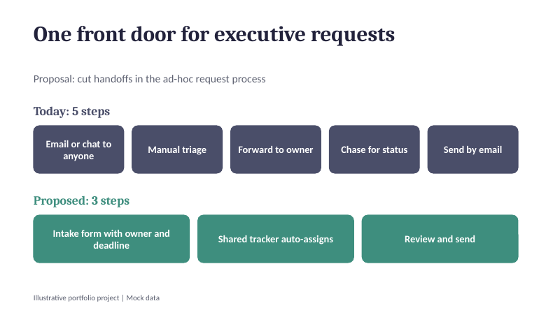
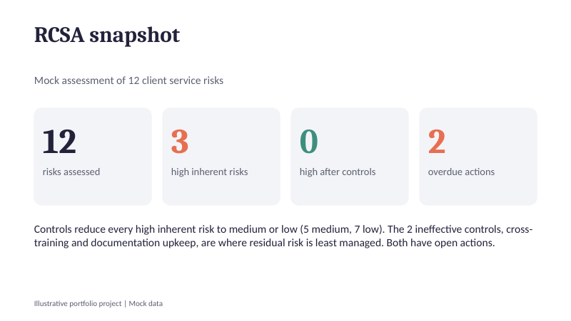

# Project 2: RCSA and Process Improvement Pack

## Objective

Show support for audit and compliance work through a mock Risk Control Self-Assessment (RCSA), and show how a team can be coordinated and a process simplified. An RCSA is a regular check on what could go wrong in operations, how well controls work, and what is left to fix.

## Contents

| File | Description |
|------|-------------|
| `Project2_RCSA_Workbook.xlsx` | Risk register, scoring scales, heatmap, action tracker and summary |
| `Project2_Process_and_TownHall_Deck.pptx` | 5-slide deck: process proposal, pilot measures, RCSA snapshot, town hall agenda |

## Method

12 invented client service risks across Basel operational risk categories. Each has a likelihood (1 to 5), an impact (1 to 5), a key control and a control effectiveness rating.

| Rule | Definition |
|------|------------|
| Inherent score | Likelihood x impact (maximum 25) |
| Control reduction | Effective 60%, Partially Effective 30%, Ineffective 0% |
| Residual score | Inherent score x (1 - control reduction) |
| Rating | High: 15 or more. Medium: 8 or more. Low: below 8 |

The reduction factors and thresholds are illustrative assumptions kept on one sheet (Scales) so they are easy to change. A real bank would use its own approved methodology.

## Key formulas

| Purpose | Formula |
|---------|---------|
| Inherent score | `=F2*G2` |
| Rating | `=IF(H2>=Scales!$B$10,"High",IF(H2>=Scales!$B$11,"Medium","Low"))` |
| Control reduction | `=INDEX(Scales!$B$4:$B$6, MATCH(K2, Scales!$A$4:$A$6, 0))` |
| Residual score | `=H2*(1-L2)` |
| Heatmap cell | `=COUNTIFS(likelihood_range, row_number, impact_range, column_number)` |
| Action flag | `=IF(F4="Complete","Done",IF(E4<$B$1,"OVERDUE",IF(E4-$B$1<=14,"Due soon","On track")))` |

Worked example: a wrong client report (likelihood 4, impact 4) scores 16, which is High. With an Effective control the residual score is 16 x 0.4 = 6.4, which is Low.

## Results (on the mock data)

- 12 risks assessed; 3 high before controls, 0 high after controls (5 medium, 7 low)
- 2 controls rated Ineffective: cross-training and documentation upkeep. Their risk is not reduced at all, so they need the most attention
- 8 remediation actions tracked; 7 open, 2 overdue at the report date (31 Oct 2026)

## Process improvement proposal

Executive requests today take 5 steps: email to anyone, manual triage, forward to owner, chase for status, send by email. The proposal is 3 steps: an intake form with owner and deadline, a shared tracker that assigns work, and a review before sending. That is 40% fewer steps.

A 4-week pilot would measure turnaround before and after. The 40% is a reduction in steps, **not a proven time saving**.

## Town hall

The deck includes a 60-minute agenda: welcome, performance and priorities, process improvement, recognition, Q&A and next steps.

## Limitations

- All risks, scores, owners and dates are invented.
- Scoring thresholds and control reduction factors are the author's assumptions.
- The process benefit is a hypothesis to test in the pilot, not a result.
